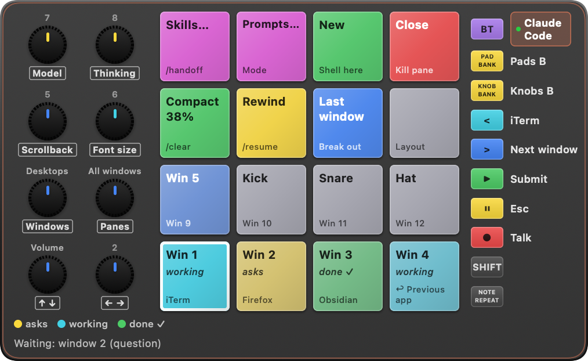

# Paddington

A macOS menu-bar app that turns an **M-VAVE SMC-PAD** (16 pads, 8 knobs, Bluetooth MIDI) into a control surface
for agentic coding: tmux windows running Claude Code and Codex, plus layers for the browser, meetings and Discord.
The pads light up with each agent's status, and the layer follows whatever is in front.



*The legend (hold ▶) draws the pad as Paddington sees it. Here a Claude Code pane is in front. Window 2 asks a question,
window 3 is done, and the grey text on a pad or knob is its bank-B action.*

## What it does

- **Agent status on the pads.** Each tmux window gets a pad whose colour is its agent's state: cyan working, yellow asks,
  magenta approve?, green done, red error. Waiting pads blink. Observe-only Claude Code and Codex hooks provide the status.
- **Answer from the pad.** A question's options become pads, and a permission prompt gets red ✕ / green ✓ in the
  middle four pads. Hold `<` for an overview of every agent, with optional sounds when one needs you.
- **Layers that follow focus:** Claude Code, Codex, tmux, browser (tabs, sites, YouTube, GitHub), Meet / Teams,
  Discord, fullscreen video, and a default layer for everything else.
- **Lists on the knobs:** model, thinking level, skills, prompts, sites and windows. Any knob scrolls, and the green pad picks.
- **Voice** through VoiceInk: ● talks, and ▶ presses Enter once the text is in. Skills, prompts and sites open as
  searchable lists: type or say what you want, ↵ or ▶ takes it.
- **Pad lights over Bluetooth**, using seven hues that are easy to tell apart. Every pad with nothing to do plays a TR-707 drum; hold one to record your own sound for it.
- **Everything is TOML** in `~/.config/paddington/`, and edits hot-reload.

## Requirements

- An **M-VAVE SMC-PAD**, paired over Bluetooth (USB isn't supported)
- macOS 14+ and Swift 6 to build
- **tmux** inside **iTerm2** for the agent and tmux features, with **Claude Code** and/or **Codex** running in tmux windows
- Optional: VoiceInk for ● Talk (its push-to-talk key set to right ⌘), Firefox for the most-visited part of
  Sites…, and workmux for the worktree entries in the New… list. Without them, only those bindings are affected.

The shipped layers are one person's setup (app slots for iTerm, Firefox and Obsidian, for example). Edit them freely.

## Quick start

```sh
./scripts/build-app.sh    # builds ~/Applications/Paddington.app and links ~/.local/bin/paddington
paddington init           # copies the default config to ~/.config/paddington (never overwrites)
paddington start          # menu-bar icon; grant Accessibility and Bluetooth when asked
paddington learn          # press every pad, turn every knob: writes the device profile
paddington hooks install  # observe-only Claude Code + Codex hooks (in Codex, approve them once with /hooks)
paddington doctor         # checks config, tmux, hooks and the pad
```

`padctl`, the old name, still works as a short alias. Press BT on the pad and Paddington connects by itself.
Logs are in `~/Library/Logs/paddington.log`.

`build-app.sh` signs with the first Apple Development or Developer ID identity in your keychain, or with
`PADDINGTON_SIGN_IDENTITY`. Without one it signs ad hoc, and macOS asks for Accessibility and Bluetooth again
after every rebuild.

## Configuration

Each file in `~/.config/paddington/layers/` is a layer. The comments at the top of
[`config/layers/default.toml`](config/layers/default.toml) explain the binding syntax and the layout rules:
rows 1–2 are windows or tabs, row 3 holds the app's verbs, and row 4 has lists, then New on 15 and Close on 16.
Prompts are Markdown files in `prompts/`. `paddington apps` prints the bundle id for a new layer's `when`.
Set `projects_dir` in `config.toml` to the folder that holds your projects: New starts agents there, and the
"Claude in…" lists show its subfolders.

## Security

Paddington holds Accessibility, Automation and microphone permissions, and it types keys and runs the commands
in your TOML files. Its control socket (`~/Library/Application Support/paddington/paddington.sock`, mode 0600)
takes commands from any process running as you. That is the same trust it gives your config folder, which it
reloads on every save. The Claude Code and Codex hooks only report status: they never approve or block anything.

## Development

```sh
swift test                    # engine tests, no hardware needed
paddington monitor            # raw MIDI and what it maps to
paddington simulate pad3 tap  # drive the running app without the pad
```

What the pad itself reports (settings memory, SHIFT, NOTE REPEAT) is in
[docs/smc-pad-findings.md](docs/smc-pad-findings.md). The LED protocol comes from
[spectalive/smc-pad](https://github.com/spectalive/smc-pad), and the TR-707 samples are public domain.

## License

[MIT](LICENSE)
